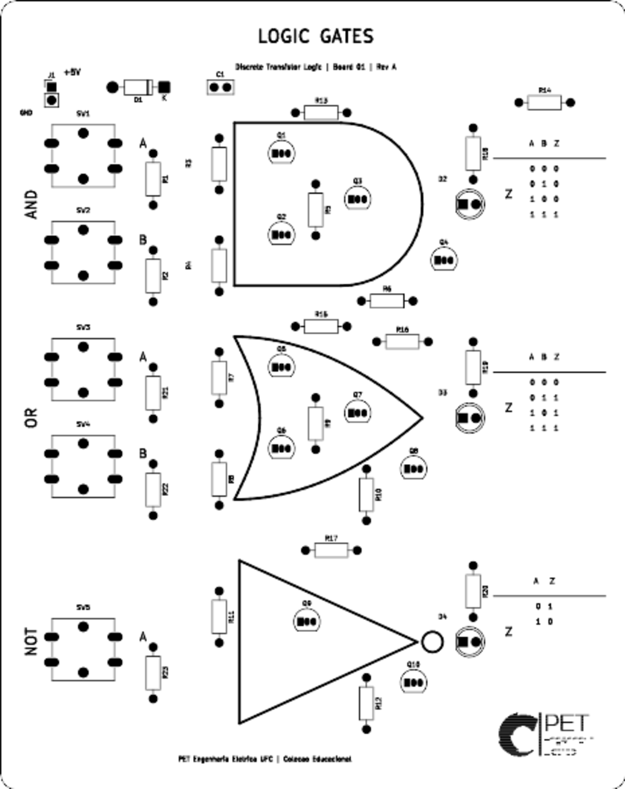

# Placa 01 — Portas lógicas com transistores discretos

Placa didática do PET Engenharia Elétrica UFC com portas **AND, OR e NOT** construídas somente com transistores 2N3904. Cada porta tem entradas por botões independentes, saída elétrica acessível nos pads do circuito e LED indicador. O projeto nativo KiCad é editável; as imagens abaixo mostram a revisão A.

[Vista traseira](renders/01-logic-gates-back.png) · [Prévia 3D ilustrativa](renders/01-logic-gates-3d-preview.png) · [Fotografia de referência](../../assets/reference/logic-gates-reference.png) · [Esquemático PDF](manufacturing/schematic.pdf)

## Estado de engenharia

- KiCad 9.0.2: ERC **0 violações**, DRC **0 violações**, **0 pads sem conexão** e **0 problemas de paridade esquemático/PCB**. Relatórios em `reports/` e `manufacturing/`.
- Comparação independente da netlist com a PCB: **98 identidades de pino/pad e 44 valores/footprints conferidos**, incluindo polaridade do diodo e LEDs e ordem E-B-C do 2N3904.
- ngspice 44.2: **12 pontos DC** (quatro combinações de botões em 4,75, 5,00 e 5,25 V) passaram os limites adotados. O modelo de transistor/LED é simplificado e não substitui medições de protótipo.
- **Nenhuma placa física foi fabricada, montada ou medida.** A revisão A é candidata a protótipo. Conferir componentes reais e prévia do fabricante antes de encomendar.

## Uso e alimentação

Conecte **5 V regulados** em `J1`, pino 1 `+5V` e pino 2 `GND`, com limite de corrente de aproximadamente 100 mA na primeira energização. `D1` (1N5819) está em série para bloquear polaridade invertida; `C1` (100 nF) desacopla a alimentação após o diodo. O circuito não tolera sobretensão sustentada. A entrada de dois pinos foi escolhida pela montagem THT simples e pelo custo; USB-C exigiria receptáculo SMD e resistores `Rd` em CC1 e CC2. Uma fonte USB de 5 V pode ser usada com adaptador polarizado verificado, sem depender de fonte com tensão incomum.

Cada botão fecha a respectiva entrada em `VCC`. Solto, um resistor de 10 kΩ a leva a GND. `SW1/SW2` comandam AND, `SW3/SW4` comandam OR e `SW5` comanda NOT. Os LEDs acendem quando a função vale 1.

| A | B | AND | OR | NOT A |
|---:|---:|---:|---:|---:|
| 0 | 0 | 0 | 0 | 1 |
| 0 | 1 | 0 | 1 | 1 |
| 1 | 0 | 0 | 1 | 0 |
| 1 | 1 | 1 | 1 | 0 |

Os sinais `A_AND`, `B_AND`, `A_OR`, `B_OR` e `A_NOT` são independentes; a tabela combina valores iguais por conveniência didática. Soltar todos os botões equivale à primeira linha.

## Circuito e dimensionamento

`Q1/Q2` em série formam `N_AND`, invertido por `Q3` em `Y_AND`. `Q5/Q6` em paralelo formam `N_OR`, invertido por `Q7` em `Y_OR`. `Q9` é o inversor de emissor comum para `Y_NOT`. `Q4`, `Q8` e `Q10` acionam os LEDs sem colocar sua corrente diretamente nas saídas lógicas. `R13`–`R17` de 2,2 kΩ elevam as saídas; `R3`–`R12` de 10 kΩ limitam corrente de base; `R18`–`R20` de 1,5 kΩ limitam LED. A saída alta carregada pelo resistor de base seguinte é cerca de 4,04 V a 5,00 V de entrada na simulação; a baixa é cerca de 0,05–0,06 V. Os limites didáticos definidos são **baixo ≤0,4 V** e **alto ≥3,5 V**, válidos somente para esta topologia e carga prevista.

A [folha do 2N3904 da onsemi](https://www.onsemi.com/pdf/datasheet/2n3904-d.pdf) especifica a ordem **1 emissor, 2 base, 3 coletor** e `VCE(sat)` máximo de 0,2 V em `IC=10 mA, IB=1 mA`. Aqui o coletor dos inversores recebe no máximo cerca de 2,4 mA e a corrente de base calculada supera aproximadamente 0,28 mA no pior caso analisado. A razão forçada fica abaixo de 10. Esse cálculo é uma margem de projeto, não uma garantia de pior caso para todos os lotes e temperaturas. A [folha do LED TLHR5200](https://www.vishay.com/docs/83011/tlhr5200.pdf) informa `VF` típico de 2 V a 20 mA; a simulação usa um modelo de LED aproximado e indica 1,84–2,17 mA quando aceso. Em curto no LED, o resistor de 1,5 kΩ ainda limita a corrente nominal a menos de 3,7 mA com 5,25 V de entrada e tolerância de −5% do resistor.

A correspondência física `Q_NPN_EBC` ↔ `TO-92_Inline` foi conferida explicitamente. Ver mais hipóteses e cálculos em [PROJECT_CONTEXT.md](../../PROJECT_CONTEXT.md).

## Geometria e serigrafia

Contorno de aproximadamente **123 × 155 mm**, duas camadas, cantos de raio 3 mm. A fotografia não permite extrair medidas precisas; esta revisão preserva sua proporção vertical, os cinco botões à esquerda, os símbolos grandes no centro e LEDs/tabelas à direita. A serigrafia inclui a marca PET derivada do PNG fornecido, título, função dos blocos e revisão. O SVG original de identidade não foi fornecido; o traçado monocromático é uma adaptação para serigrafia, não uma reconstrução de manual de marca.

Solicitar ao fabricante **máscara branca e serigrafia preta**: os Gerbers não codificam cores. O acabamento e contraste precisam ser confirmados na prévia do fabricante. Não há furos de fixação nesta revisão para preservar área útil e fidelidade à referência.

## Montagem e teste com multímetro

1. Separe os componentes conforme [BOM.csv](manufacturing/BOM.csv). Confirme a pinagem **E-B-C** do lote de 2N3904 escolhido e o corpo de 12 × 12 mm dos botões Omron B3F-4050.
2. Solde resistores, diodo, capacitor, transistores, botões, LEDs e conector nessa ordem. Alinhe a faixa de `D1` ao cátodo e o lado chato/cátodo dos LEDs ao pad 1. Não confunda os diodos `D1` e `D2`–`D4`.
3. Com a placa desligada, meça continuidade de GND e ausência de curto entre `+5V` e GND. Inspecione pontes de solda, especialmente nos três pads próximos de cada TO-92.
4. Energize com 5,0 V e limite inicial de aproximadamente 100 mA. Meça `VCC` depois de `D1`, depois as entradas soltas (próximas de 0 V) e pressionadas (próximas de `VCC`).
5. Para cada bloco, pressione as combinações da tabela. Meça `Y_AND`, `Y_OR`, `Y_NOT` e compare com ≤0,4 V / ≥3,5 V; confira se o LED correspondente segue a saída. Um LED apagado não substitui a medida do nó lógico.
6. Desligue imediatamente se houver aquecimento, consumo inesperado ou saída fora da faixa. Anote tensão de alimentação, tensões de saída e corrente antes de concluir o ensaio físico.

## Arquivos e reprodução

- `01-logic-gates.kicad_sch`, `.kicad_pcb`, `.kicad_pro`: fontes nativas.
- `../../scripts/validate_logic_gates.sh`: gera as fontes, executa ERC, DRC, paridade, comparação da netlist e BOM.
- `../../scripts/simulate_logic_gates.py`: DC no ngspice com modelos simplificados; resultados em `reports/simulation.csv`.
- `../../scripts/render_board_previews.py`: usa KiCad CLI, ImageMagick `convert` e Pillow para gerar vistas 2D diretamente da PCB e uma prévia isométrica **ilustrativa**. Os modelos de componentes desenhados nesta imagem são aproximados.
- `../../scripts/export_logic_gates.sh`: repete validação e exporta [manufacturing/](manufacturing/). O modelo STEP/GLB usa o modelo 3D KiCad disponível para cada footprint; os botões usam um modelo de 6 mm escalado para representar o corpo 12 × 12 mm, portanto a geometria 3D deles é apenas aproximada.

O guia de aula e exercícios está em [logic-gates-lab.md](../../docs/logic-gates-lab.md). As pendências da revisão estão em [manufacturing/README.md](manufacturing/README.md).
